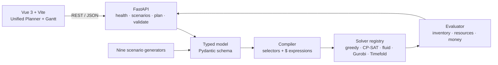

<p align="center">
  
</p>

<h1 align="center">APS · Advanced Planning &amp; Scheduling</h1>

<p align="center"><strong>Turn item flows, resources, rules, and orders into an executable production plan.</strong><br>
Model a factory in a typed JSON schema, compile it to constraints, solve it with interchangeable algorithms, and inspect the result on a Gantt chart — locally, in one workbench.</p>

<p align="center"><a href="README.zh-CN.md">简体中文</a> · English</p>

<p align="center">
  <a href="LICENSE"></a>
  <a href="backend/pyproject.toml"></a>
  <a href="frontend/package.json"></a>
  <a href="backend/tests"></a>
</p>

> **Status: closed milestone (2026-09-29).** The workbench reached its goal: a
> runnable, inspectable prototype with a unified model, multiple solvers, nine
> scenarios, and a browser UI. Development is paused unless the project's
> inputs or goals change.

## Quick start

Prerequisites: Python **3.12+**, Node.js/npm, and [uv](https://docs.astral.sh/uv/) (or your own Python environment). The default backend install includes FastAPI, Pydantic, OR-Tools, Gurobi Python bindings, and PyTorch.

```bash
git clone https://github.com/ZisIsNotZis/aps.git
cd aps

cd frontend && npm ci && cd ..
cd backend && uv sync && cd ..

./run.sh
```

Open <http://localhost:5173>. The API listens on <http://localhost:8000> and exposes a health check at `/api/health`. Start one side only with `./run.sh -b` (backend) or `./run.sh -f` (frontend).

Then: pick a built-in scenario, press **Load Scenario**, and press **Run Plan**. The planner shows order outcomes, scheduled blocks, makespan, solver time, and an SVG Gantt chart.

## What it can do now

- **Unified Planner UI** — load a scenario, inspect and edit entities, rules, and orders, run a plan, and read the resulting Gantt chart in the browser.
- **Typed planning model** — entities, selectors, transformation rules, orders, holding rules, deadlines, release times, and money-based objectives, validated with Pydantic.
- **Compiler and evaluator** — validates the model, compiles restricted `$` expressions, simulates inventory and resource effects, and scores the result.
- **Swappable solvers** — list scheduling, OR-Tools CP-SAT, and a fluid/proportional-fairness simulator in-tree, plus optional Gurobi and Timefold plugins behind the same interface.
- **Nine manufacturing scenarios** — discrete manufacturing, electronics SMT, job shop, assembly line, automotive stamping, furniture, food processing, pharma, and semiconductor.
- **Small HTTP API** — `GET /api/health`, `GET /api/unified/scenarios`, `GET /api/unified/scenarios/{id}`, `POST /api/unified/plan`, and `POST /api/unified/validate`.

### Solvers at a glance

| Solver | Approach | Notes |
|---|---|---|
| `greedy` | Interleaved BOM-order list scheduling | Fastest baseline; usually more blocks |
| `cp_sat` | OR-Tools CP-SAT | Default; strongest money objective on most recorded scenarios |
| `fluid` | Proportional fairness + ASAP simulation | Feasibility-oriented; competitive money |
| `gurobi` | Mixed-integer programming | Optional; needs a Gurobi license |
| `timefold` | Java sidecar | Experimental; needs Java 21+ and a built JAR |

On the project's recorded scenario suite, `greedy`, `cp_sat`, and `fluid` each fulfilled all orders (9/9). Average solve times were roughly **1s**, **20s**, and **14s** respectively on that benchmark setup. These are project-specific experiments, not general guarantees — see [`docs/benchmark-results.md`](docs/benchmark-results.md) and [`backend/aps/unified/solvers/README.md`](backend/aps/unified/solvers/README.md).

### Known limits

- The development server is local-only by default; CORS allows local frontend origins.
- Gurobi needs a valid installation and license. Timefold needs Java 21+, Maven, and its built JAR. Both are optional.
- Solver output can be heuristic or time-limited. Validate schedules against real capacity, calendars, quality, safety, and business constraints before acting on them.
- `docs/archive/` contains earlier design notes; [`docs/unified-aps-model.md`](docs/unified-aps-model.md) is the canonical model specification.

## Architecture



- `frontend/` — Vue 3 + Vite workbench; `UnifiedPlanner.vue` owns the scenario, model, result, and Gantt views.
- `backend/aps/unified/_schema.py` — the `PlanningModel` contract; `_compile.py` turns it into a timed plan, `_expr.py` implements the restricted expression DSL, and `_evaluate.py` scores schedules.
- `backend/aps/unified/_solve.py` + `solvers/` — solver registration and dispatch; every plugin implements `solve(CompiledPlan, SolverConfig) -> SolverResult`.
- `backend/aps/unified/scenarios/` — one generator per scenario plus the registry that lists them.
- `docs/` — canonical model spec, design-doc index, benchmark records, and archived notes.
- `run.sh` — starts the backend (uvicorn, hot reload) and frontend (Vite, HMR) together.

## How to develop

Backend checks:

```bash
cd backend
uv sync
uv run pytest
uv run ruff check .
```

Frontend build and tests:

```bash
cd frontend
npm ci
npm run build
npx playwright test   # specs live in frontend/tests; see playwright.config.js for the expected base URL
```

To extend the project:

- Add a scenario under `backend/aps/unified/scenarios/` and register it in `registry.py`.
- Add a solver under `backend/aps/unified/solvers/`, register it with `@register_solver("name")`, and import it from `_solve.py`.
- Rerun `backend/benchmark_solvers.py` or `backend/benchmark_scale.py` when solver behavior changes; record results beside the existing benchmark docs.

## How to contribute

Issues and focused pull requests are welcome. For solver changes, include a small reproducible model and report the effect on objective, makespan, and block count; update tests when behavior changes. Read [`CONTRIBUTING.md`](CONTRIBUTING.md), [`SECURITY.md`](SECURITY.md), and [`CODE_OF_CONDUCT.md`](CODE_OF_CONDUCT.md) before opening a change.

Agents are welcome to triage issues, reproduce failures, add tests, and update docs. Maintainers review and merge contributions.

## Roadmap

### Implemented

- Unified typed model covering entities, selectors, rules, orders, holding rules, deadlines, release times, and money objectives.
- Compiler, evaluator, and restricted `$` expression DSL with validation.
- Greedy, CP-SAT, and fluid solvers in-tree; optional Gurobi and Timefold plugins.
- Nine registered manufacturing scenarios with a browser scenario picker.
- Unified Planner UI with model inspection, plan execution, and an SVG Gantt chart.
- Health, scenario, plan, and validate HTTP endpoints.
- Backend unit tests and Playwright frontend specs; recorded solver benchmark reports.

### Planned

- Stabilize the model/schema and error messages.
- Make solver selection and time limits explicit in the UI/API.
- Expand correctness and performance benchmarks with reproducible hardware and configuration.
- Improve persistence, import/export, and scenario authoring.
- Harden authentication, deployment, and operational observability before any network-facing use.
- Complete Timefold material-flow constraints and reward calibration; a commercial Gurobi license would unlock larger models.

### Future vision

APS could become a transparent planning laboratory or an embeddable scheduling service for teams that want to inspect and tailor the optimization layer. That depends on stronger validation, explainability, and production hardening — not on adding more surface area for its own sake.

## Versioning

The backend package is `0.1.0`; the frontend is an internal `0.0.0` app. Release notes live in Git history. See [`docs/project-status.md`](docs/project-status.md) for scope and evidence.

## License

APS is available under the [GNU Affero General Public License v3.0-only](LICENSE).
