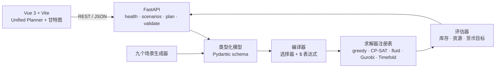

[English](README.md) | **简体中文**

<p align="center">
  
</p>

<h1 align="center">APS · 高级计划与排程</h1>

<p align="center"><strong>把物料流、资源、规则与订单，变成可执行的生产计划。</strong><br>
用类型化 JSON 模型描述工厂，编译成约束，换用不同算法求解，再在甘特图上检查结果——全部在本地一个工作台里完成。</p>

<p align="center">
  <a href="LICENSE"></a>
  <a href="backend/pyproject.toml"></a>
  <a href="frontend/package.json"></a>
  <a href="backend/tests"></a>
</p>

> **状态：已收口（里程碑，2026-09-29）。** 工作台已达成目标：一个可运行、可检查的原型，包含统一模型、多种求解器、九个场景和浏览器界面。除非项目输入或目标变化，开发暂告一段落。

## 快速开始

依赖：Python **3.12+**、Node.js/npm，以及 [uv](https://docs.astral.sh/uv/)（也可以使用自己的 Python 环境）。默认后端安装包含 FastAPI、Pydantic、OR-Tools、Gurobi Python bindings 和 PyTorch。

```bash
git clone https://github.com/ZisIsNotZis/aps.git
cd aps

cd frontend && npm ci && cd ..
cd backend && uv sync && cd ..

./run.sh
```

打开 <http://localhost:5173>。API 监听 <http://localhost:8000>，健康检查位于 `/api/health`。也可以用 `./run.sh -b` 只启动后端，或用 `./run.sh -f` 只启动前端。

接着：选择一个内置场景，点击 **Load Scenario**，再点击 **Run Plan**。界面会展示订单结果、已排计划块、总工期、求解时间和 SVG 甘特图。

## 现在能做什么

- **Unified Planner 界面**——加载场景，检查并编辑实体、规则和订单，运行计划，然后在浏览器里查看甘特图。
- **类型化计划模型**——实体、选择器、转换规则、订单、库存持有规则、截止时间、释放时间和货币目标，全部通过 Pydantic 校验。
- **编译器与评估器**——校验模型、编译受限 `$` 表达式、模拟库存与资源影响，并对结果打分。
- **可替换求解器**——内置列表排程、OR-Tools CP-SAT 和 fluid 比例公平模拟，另有同一接口下的可选 Gurobi 与 Timefold 插件。
- **九个制造场景**——离散制造、电子 SMT、作业车间、装配线、汽车冲压、家具、食品加工、制药和半导体。
- **精简 HTTP API**——`GET /api/health`、`GET /api/unified/scenarios`、`GET /api/unified/scenarios/{id}`、`POST /api/unified/plan` 与 `POST /api/unified/validate`。

### 求解器速览

| 求解器 | 方法 | 说明 |
|---|---|---|
| `greedy` | 按 BOM 顺序交错的列表排程 | 最快的基线；计划块通常更多 |
| `cp_sat` | OR-Tools CP-SAT | 默认求解器；在多数已记录场景中货币目标最好 |
| `fluid` | 比例公平 + ASAP 模拟 | 面向可行性；货币表现有竞争力 |
| `gurobi` | 混合整数规划 | 可选；需要 Gurobi 许可证 |
| `timefold` | Java sidecar | 实验性；需要 Java 21+ 和构建好的 JAR |

在项目记录的场景套件上，`greedy`、`cp_sat` 和 `fluid` 都完成了全部订单（9/9）。该基准设置下的平均求解时间约为 **1 秒**、**20 秒**和 **14 秒**。这些只是项目内实验，不构成通用保证——参见 [`docs/benchmark-results.md`](docs/benchmark-results.md) 与 [`backend/aps/unified/solvers/README.md`](backend/aps/unified/solvers/README.md)。

### 已知限制

- 开发服务器默认只面向本地；CORS 仅允许本地前端来源。
- Gurobi 需要有效安装和许可证；Timefold 需要 Java 21+、Maven 和构建好的 JAR。两者都是可选项。
- 求解结果可能是启发式或受时间限制的。投入实际使用前，请按真实产能、日历、质量、安全和业务约束复核排程。
- `docs/archive/` 存放早期设计笔记；[`docs/unified-aps-model.md`](docs/unified-aps-model.md) 是模型语义的唯一权威说明。

## 架构

工作台分成两个进程：Vue 3 单页应用负责建模与可视化，FastAPI 后端负责模型契约、编译器、求解器插件和评估器。两者通过一套精简的 JSON API 通信——前端不导入任何排程逻辑，因此求解器可以单独替换，也可以直接在 Python 里无界面地跑基准。

```text
aps/
├── backend/
│   ├── main.py                  # uvicorn 入口（导出 aps.api:app）
│   ├── aps/unified/             # _schema · _compile · _expr · _evaluate · _solve
│   │   ├── solvers/             # greedy · cp_sat · fluid · gurobi · timefold
│   │   └── scenarios/           # 九个场景生成器 + 注册表
│   ├── tests/                   # pytest 用例（模型、编译、求解、API）
│   └── benchmark_*.py           # 求解器基准驱动与导出的 JSON
├── frontend/
│   ├── src/components/UnifiedPlanner.vue   # 场景选择、模型编辑、结果与甘特图
│   ├── src/App.vue
│   └── tests/                   # Playwright 用例
├── docs/                        # 模型说明、设计索引、基准记录和归档
├── run.sh                       # 同时启动前后端开发服务器
└── aps-logo.svg
```



- `frontend/`——Vue 3 + Vite 工作台；`UnifiedPlanner.vue` 负责场景、模型、结果和甘特图视图。
- `backend/aps/unified/_schema.py`——`PlanningModel` 契约；`_compile.py` 把它编译成带时间的计划，`_expr.py` 实现受限表达式 DSL，`_evaluate.py` 为排程打分。
- `backend/aps/unified/_solve.py` + `solvers/`——求解器注册与分发；每个插件都实现 `solve(CompiledPlan, SolverConfig) -> SolverResult`。
- `backend/aps/unified/scenarios/`——每个场景一个生成器，另有负责列出场景的注册表。
- `docs/`——权威模型说明（[`unified-aps-model.md`](docs/unified-aps-model.md)）、[设计文档索引](docs/design-doc-index.md)、基准记录和归档笔记。
- `run.sh`——同时启动后端（uvicorn，热重载）和前端（Vite，HMR）。

## 如何开发

后端检查：

```bash
cd backend
uv sync
uv run --with pytest --with httpx pytest   # pytest/httpx 仅测试用，不在项目依赖里
uv run --with ruff ruff check .             # lint 配置在 pyproject.toml
```

前端构建与测试：

```bash
cd frontend
npm ci
npm run build
npx playwright install                      # 仅首次：下载浏览器二进制
npm run dev -- --port 5174 &                # Playwright 预期访问 http://127.0.0.1:5174
npx playwright test                         # 用例位于 frontend/tests
```

要扩展项目：

- 在 `backend/aps/unified/scenarios/` 下新增场景，并在 `registry.py` 中注册。
- 在 `backend/aps/unified/solvers/` 下新增求解器，用 `@register_solver("name")` 注册，并在 `_solve.py` 中导入。
- 求解器行为变化时，重跑 `backend/benchmark_solvers.py` 或 `backend/benchmark_scale.py`，并把结果记录到现有基准文档旁边。

## 如何贡献

欢迎提交 issue 和聚焦的 Pull Request。修改求解器时，请附带可复现的小模型，并说明对目标值、总工期和计划块数量的影响；行为变化时请更新测试。开始前请阅读 [`CONTRIBUTING.md`](CONTRIBUTING.md)、[`SECURITY.md`](SECURITY.md) 和 [`CODE_OF_CONDUCT.md`](CODE_OF_CONDUCT.md)。

Agent 可以协助分类 issue、复现故障、添加测试和更新文档；维护者负责审查并合并贡献。

## 路线图

### 已实现

- 统一的类型化模型，覆盖实体、选择器、规则、订单、库存持有规则、截止时间、释放时间和货币目标。
- 编译器、评估器，以及带校验的受限 `$` 表达式 DSL。
- 内置 greedy、CP-SAT 和 fluid 求解器；可选的 Gurobi 与 Timefold 插件。
- 九个已注册的制造场景，以及浏览器中的场景选择器。
- Unified Planner 界面：模型检查、计划执行和 SVG 甘特图。
- 健康检查、场景、计划与校验四类 HTTP 端点。
- 后端单元测试和 Playwright 前端用例；已记录的求解器基准报告。

### 计划中

- 稳定模型/schema 与错误信息。
- 在 UI/API 中明确求解器选择和时间限制。
- 用可复现的硬件与配置扩充正确性和性能基准。
- 改进持久化、导入导出和场景编写。
- 在面向网络部署前完善认证、部署和可观测性。
- 完成 Timefold 的物料流约束与奖励校准；商业 Gurobi 许可证可以解锁更大的模型。

### 未来愿景

APS 可以成为透明的排程实验室，或成为可嵌入的调度服务，让团队检查并调整优化层。这取决于更强的验证、可解释性和生产级加固，而不是为了增加界面而增加界面。

## 版本管理

后端包为 `0.1.0`，前端是内部 `0.0.0` 应用。发布说明记录在 Git 历史中。范围与证据见 [`docs/project-status.md`](docs/project-status.md)。

## 许可证

APS 使用 [GNU Affero General Public License v3.0-only](LICENSE) 授权。
